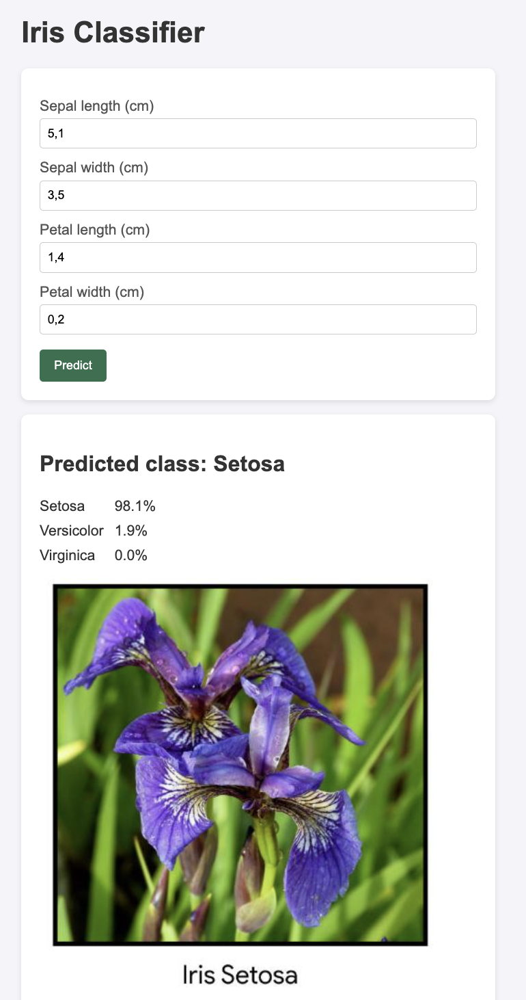
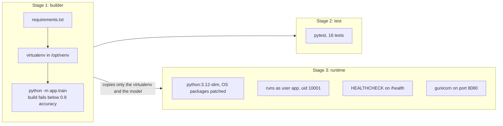
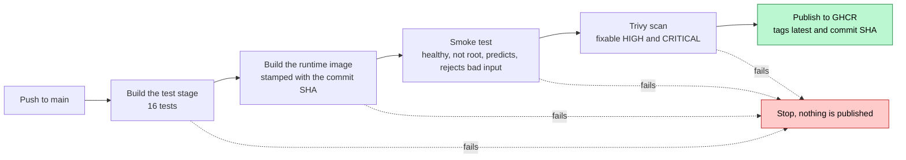

# IE7374 Lab Assignment 6: A Production Ready Container for an ML Model

[](https://github.com/lequo-neu/IE7374-Docker-Assignment6/actions/workflows/container.yml)

An Iris classifier packaged the way a model should be shipped to production. The
model is trained and checked while the image is built, the tests run inside the
same environment that ships, and the running container is small, has no root
user, reports its own health, and can say exactly which commit it was built from.
Every push goes through a CI pipeline that builds the image, runs it, probes it,
scans it for known vulnerabilities, and only then publishes it.

Try it without cloning anything:

```
docker run --rm -p 8090:8080 ghcr.io/lequo-neu/ie7374-docker-assignment6:latest
```

Then open http://localhost:8090.



## At a Glance

| What to check | Answer |
|---|---|
| Based on | Docker_Labs/Lab2 from the course repository |
| Core concept changed | The container itself: a three stage build, a hardened runtime image, and a CI pipeline for the image. See [How the Image Is Built](#how-the-image-is-built) |
| Bugs fixed from the original | 6, including a port mismatch that left the original unreachable. See [Bugs Fixed](#bugs-fixed-from-the-original-lab) |
| Advanced extension | CI/CD for the container: build, test, smoke test, scan, publish. See [Advanced Extension](#advanced-extension-a-cicd-pipeline-for-the-container) |
| Proof that it works | The badge above, the published image you can pull, and the CI output below |
| Run it yourself | One docker run command above, or build it locally. See [Running the Code](#running-the-code) |

## How the Image Is Built



The builder stage installs the dependencies into a virtual environment and trains
the model. Training during the build means the model is created with exactly the
libraries it will be served with, and a model under 90 percent test accuracy
stops the build before an image exists.

The test stage starts from the builder and runs all 16 tests against that exact
environment. It is only built when asked for with --target test, so it adds
nothing to the shipped image.

The runtime stage starts again from a clean slim base and copies across only the
virtual environment and the trained model. Compilers, pip caches, test tools and
the build context never reach it.

## What CI Does on Every Push



An image only reaches the registry if every gate before it passes, so anything
pulled from ghcr.io/lequo-neu/ie7374-docker-assignment6 has been built, tested,
run, probed and scanned.

## Bugs Fixed from the Original Lab

| Bug in the original | Effect | Fix |
|---|---|---|
| Flask listens on port 4000, the image exposes 80, compose maps 80:80 | Nothing answers on the published port | One port, 8080, used by gunicorn, the image and every command. The CI smoke test calls it |
| The model is trained on standardized features but served raw measurements | Every prediction is made on the wrong scale | The scaler lives inside a scikit-learn pipeline saved with the model. A test predicts all three species from raw centimetres |
| app.run(debug=True) inside the container | The Flask documentation warns never to run debug mode in production, because its interactive debugger can execute arbitrary code | gunicorn with two workers, no debug mode |
| docker-compose.yml points at Dockerfile but the file is called dockerfile | Works on macOS, fails on Linux, where file names are case sensitive | The file is named Dockerfile |
| depends_on does not wait for training to finish, and the shared volume is never used | Serving can start before a model exists | The model is trained during the build and baked into the image |
| Invalid input returns HTTP 200 with an error key | Clients cannot tell a failure from a success | HTTP 400 with a message that names the bad field |

## Changes Made to the Lab

| Area | Original Lab2 | This version |
|---|---|---|
| Base image | python:3.10, the full image | python:3.12-slim, with OS packages patched at build time |
| Model | TensorFlow Keras network | scikit-learn pipeline, StandardScaler and LogisticRegression |
| Build stages | 2, both installing every dependency | 3: builder, test, runtime, with dependencies installed once |
| Tests | None | 16 tests, run inside the build |
| Quality gate | None | Training fails the build below 0.9 test accuracy |
| Server | Flask development server in debug mode | gunicorn |
| User | root | app, uid 10001 |
| Health | None | HEALTHCHECK calling /health |
| Runtime restrictions | None | Read only file system, all Linux capabilities dropped, no privilege escalation |
| Traceability | None | Commit SHA in an OCI label and in the /health response, exact package list inside the image |
| Build context | Everything in the folder | Trimmed by .dockerignore |
| Web page | jQuery loaded from a CDN | Plain JavaScript, no external requests, shows class probabilities |
| CI/CD | None | Build, test, smoke test, scan and publish on every push |

**Why the model changed from TensorFlow to scikit-learn**

The subject of this lab is the container, not the model. TensorFlow makes the
image several times larger and slower to build, and it is hard to install on
Apple Silicon, all for a four feature dataset that logistic regression handles
with 93 percent test accuracy. A scikit-learn pipeline also makes the scaling
bug impossible to repeat, because the scaler and the model are saved and loaded
as one object.

### How the Runtime Is Hardened

| Practice | How it is done | How it is verified |
|---|---|---|
| Small image | Slim base, only the virtualenv and the model copied in | 380 MB on CI |
| No root | Dedicated user app with uid 10001 | CI checks the user id inside the running container |
| Health reporting | HEALTHCHECK calls /health every 15 seconds | Status healthy in docker compose ps and in CI |
| Least privilege | Read only root file system, tmpfs for /tmp, all capabilities dropped, no new privileges | CI runs the container with these restrictions and it stays healthy |
| Patched OS | apt-get upgrade in the runtime stage | Trivy scan |
| Traceable builds | GIT_SHA build argument written to an OCI label and returned by /health, package list saved at /srv/installed-packages.txt | /health on CI returns the commit it was built from |

## Advanced Extension: A CI/CD Pipeline for the Container

**Why this was chosen**

A Dockerfile that builds on one laptop proves very little. The original lab's
compose file only works on macOS because of the file name, and nobody would have
noticed until it ran on Linux. In production, images are built by machines, pulled by other
machines, and run without anyone watching. The only way to trust an image is for
an automated pipeline to prove, every time, that it builds, that its tests pass,
that it actually starts and answers, and that it carries no known fixable
vulnerability. This also matches what the course project needs for deployment:
a container image published by CI, ready for a cloud service to pull.

**How it works**

The workflow runs on every push and pull request. It builds the test stage first,
so a failing test stops everything. It then builds the runtime image with the
commit SHA as a build argument and starts it with the same restrictions used in
production: a read only file system and no Linux capabilities. It waits for
Docker to report the container healthy, checks that it is not running as root,
sends a valid prediction and an incomplete one, and expects Setosa and HTTP 400.
Trivy then scans the image and fails the run on any HIGH or CRITICAL vulnerability
that already has a fix. Only on a push to main is the image tagged with latest
and with the commit SHA and pushed to GitHub Container Registry.

The Trivy action is pinned to a full commit SHA rather than a version tag. In
March 2026, attackers used stolen credentials to force push most of that
action's version tags to credential stealing malware. A tag can be moved to
different code, a commit SHA cannot.

**What it produces**

A public image anyone can run with one command, and a guarantee attached to it:
every published tag passed all five gates. Each image can be traced back to its
commit through the SHA tag, the OCI label, and the /health endpoint.

## Prerequisites

Docker Desktop. Download from https://www.docker.com/products/docker-desktop and
verify with: docker --version

Python 3.12, only needed to run the tests outside Docker. Download from
https://www.python.org/downloads and verify with: python3.12 --version

Git. Download from https://git-scm.com and verify with: git --version

Dependencies are listed in requirements.txt with minimum versions: Flask 3.1,
gunicorn 23, scikit-learn 1.8 and joblib 1.5. In the published CI build they
resolved to Flask 3.1.3, gunicorn 26.2.0, scikit-learn 1.9.1 and joblib 1.6.0.
The exact versions inside any built image are recorded in
/srv/installed-packages.txt.

## Environment Setup

Clone the repository.

```
git clone https://github.com/lequo-neu/IE7374-Docker-Assignment6.git
cd IE7374-Docker-Assignment6
```

To run the tests outside Docker, create a virtual environment.

```
python3.12 -m venv venv
source venv/bin/activate
pip install -r requirements.txt -r requirements-dev.txt
```

## Running the Code

Run the tests directly.

```
pytest -v
```

Run the same tests inside the image build.

```
docker build --target test -t iris-classifier:test .
```

Build and start the hardened runtime container.

```
docker compose up -d --build
docker compose ps
```

Call the API.

```
curl http://localhost:8090/health
curl -X POST http://localhost:8090/predict -H "Content-Type: application/json" -d '{"sepal_length": 5.1, "sepal_width": 3.5, "petal_length": 1.4, "petal_width": 0.2}'
curl -i -X POST http://localhost:8090/predict -H "Content-Type: application/json" -d '{"sepal_length": 5.1}'
```

Check which user the container runs as, then stop it.

```
docker compose exec api id
docker compose down
```

The host port defaults to 8090 and can be changed with the APP_PORT environment
variable, for example APP_PORT=9000 docker compose up -d.

## What a Successful Run Looks Like

| Check | Result |
|---|---|
| Tests on the host | 16 passed |
| Tests inside the image build | 16 passed |
| Model test accuracy | 0.9333, above the 0.9 gate |
| Container health | healthy, both locally and on CI |
| User inside the container | uid 10001, not root |
| Valid prediction | Setosa with probability 0.9808 |
| Incomplete body | HTTP 400 naming the three missing fields |
| Image size | 380 MB on CI for linux/amd64, 577 MB on an Apple Silicon Mac for linux/arm64 |
| Vulnerability scan | 0 fixable HIGH or CRITICAL findings across all 18 scanned targets: the Debian 13.7 base and 17 Python packages |
| Published image | Pulls from ghcr.io without logging in |

The size differs by platform because the scientific libraries ship separate
builds for each processor architecture.

**Tests inside the build**

```
16 passed in 0.05s
```

**CI smoke test**

```
Health status: healthy
Container user id: 10001
{"image_revision":"99b63548f4415e9f6efd13647e380d73f07f146d","model":"StandardScaler + LogisticRegression","status":"ok","test_accuracy":0.9333,"trained_at":"2026-10-10T00:18:22+00:00"}
{"predicted_class":"Setosa","probabilities":{"Setosa":0.9808,"Versicolor":0.0192,"Virginica":0.0}}
Status for an incomplete body: 400
```

The image_revision field holds the commit SHA that CI passed in as a build
argument, so a running container can always say which code it came from.

**CI vulnerability scan**

Trivy checked the operating system layer and every Python package installed in
the image. The scan uses a HIGH and CRITICAL severity filter with ignore-unfixed,
so these counts are serious findings that already have a patch. The step fails
the run on any such finding.

| Scanned target | Type | Findings |
|---|---|---|
| iris-classifier:ci, Debian 13.7, 87 OS packages | debian | 0 |
| flask 3.1.3, werkzeug 3.1.9, jinja2 3.1.6, markupsafe 3.0.4, itsdangerous 2.2.0, click 8.5.0, blinker 1.9.0 | python-pkg | 0 |
| gunicorn 26.2.0 | python-pkg | 0 |
| scikit-learn 1.9.1, scipy 1.18.1, numpy 2.5.3, joblib 1.6.0, threadpoolctl 3.7.0, narwhals 2.26.0, cloudpickle 3.1.2 | python-pkg | 0 |
| pip 25.0.1, in the virtualenv and in the base Python | python-pkg | 0 |

An excerpt of the raw report:

```
│ iris-classifier:ci (debian 13.7)                                             │   debian   │        0        │
│ opt/venv/lib/python3.12/site-packages/flask-3.1.3.dist-info/METADATA         │ python-pkg │        0        │
│ opt/venv/lib/python3.12/site-packages/gunicorn-26.2.0.dist-info/METADATA     │ python-pkg │        0        │
│ opt/venv/lib/python3.12/site-packages/scikit_learn-1.9.1.dist-info/METADATA  │ python-pkg │        0        │
│ opt/venv/lib/python3.12/site-packages/werkzeug-3.1.9.dist-info/METADATA      │ python-pkg │        0        │
```

The scan covers vulnerabilities only. Its secrets column reads not scanned for
these targets, so this report makes no claim about secrets.

**Local container**

```
NAME                              IMAGE                   STATUS                    PORTS
ie7374-docker-assignment6-api-1   iris-classifier:local   Up 20 seconds (healthy)   0.0.0.0:8090->8080/tcp
```

```
HTTP/1.1 400 BAD REQUEST
Server: gunicorn
Content-Type: application/json

{"error":"Missing fields: sepal_width, petal_length, petal_width"}
```

```
uid=10001(app) gid=10001(app) groups=10001(app)
```

The Server header confirms requests are handled by gunicorn rather than the
Flask development server.

**Pulling the published image**

```
latest: Pulling from lequo-neu/ie7374-docker-assignment6
Digest: sha256:01bd3394a53d45158ca23e31aa69339382089c46844016ef95ffb8a2d55549a6
Status: Downloaded newer image for ghcr.io/lequo-neu/ie7374-docker-assignment6:latest
```

## Project Structure

```
IE7374-Docker-Assignment6/
    .github/
        workflows/
            container.yml       (build, test, smoke test, scan, publish)
    app/
        __init__.py
        train.py                (trains the model, fails below 0.9 accuracy)
        main.py                 (Flask app factory: page, /health, /predict)
        templates/
            index.html          (web page, no external scripts)
        static/
            setosa.jpeg         (flower images from the original lab)
            versicolor.jpeg
            virginica.jpeg
    assets/
        web_ui.png
    tests/
        conftest.py             (trains a model into a temporary folder)
        test_train.py           (3 tests)
        test_api.py             (13 tests)
    Dockerfile                  (builder, test and runtime stages)
    docker-compose.yml          (hardened runtime settings)
    .dockerignore
    requirements.txt
    requirements-dev.txt
    pytest.ini
    .gitignore
    README.md
```
